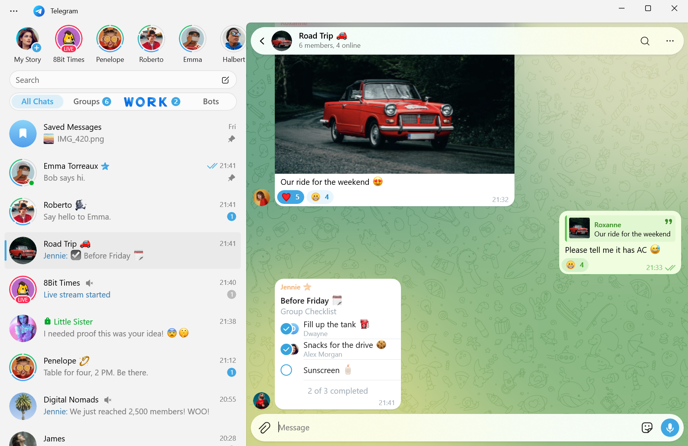

<h1 align="center">Unigram</h1>

  <b>Telegram, built for Windows.</b>
   
  Native, fast, and designed to feel right at home on Windows 10 and 11.

  

  
  
  

  <picture>
    <source media="(prefers-color-scheme: dark)" srcset="/Screenshots/Screen.dark.png">
    
  </picture>

## Why Unigram

Unigram brings Telegram to Windows with a native experience, without compromising on the features you already know and use.

- 🪟 **Made for Windows.** A familiar Fluent design, light and dark themes that follow your system, native notifications, and seamless sharing with other apps.
- ⚡ **Native performance.** Built specifically for Windows, not wrapped in a web browser. Fast, responsive, and right at home on your desktop.
- 💬 **Everything you expect from Telegram.** Chats, channels, stories, folders, secret chats, polls, stickers, and much more.
- 📞 **Stay connected.** Make voice and video calls, join group video chats, and watch live streams.
- 👥 **All your accounts in one place.** Add multiple Telegram accounts and switch between them whenever you need.
- ⌨️ **Work faster with your keyboard.** A wide range of keyboard shortcuts makes navigating Unigram a breeze. [See the full list](Documentation/Shortcuts.md).
- 🌍 **Your language, your way.** Available in over 30 languages, with support for all language packs on the Telegram translations platform.
- 🔒 **Your privacy matters.** Unigram doesn't collect any user data. Telegram's [Privacy Policy](https://telegram.org/privacy) applies.

## Stay in the loop

Follow Unigram's development and join the community:

- [Unigram News](https://t.me/unigram) — Release announcements, updates, and changelogs. You can also find every release on [GitHub](https://github.com/TelegramMessenger/Unigram/releases).
- [Unigram Insiders](https://t.me/unigraminsiders) — Join the conversation with the developers and other Unigram users.

## Help with translations

Unigram is available in over 30 languages, and there's always room for improvement. Help refine an existing translation or bring Unigram to a new language through the [Telegram translations platform](https://translations.telegram.org/en/Unigram).

## Contributing

Found a bug, have an idea, or want to suggest an improvement? Head over to the [Bugs and Suggestions Platform](https://bugs.telegram.org/?tag_ids=47&type=issues&sort=time).

If you'd like to contribute code, please take a moment to read the [contributing guidelines](/CONTRIBUTING.md) and [build instructions](Documentation/Build-instructions.md) before opening a pull request.

## Windows 10 N

Windows 10 N editions require the Media Feature Pack to run Unigram.

To install it, open `Settings > Apps and Features > Add a feature`, find and select `Media Feature Pack`, and install it. Restart Windows once the installation is complete.
